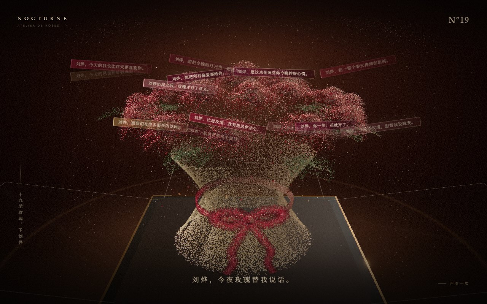

# Nocturne · 给刘烨的夜宴玫瑰

一个用 Three.js 粒子渲染的互动玫瑰礼盒页面。19 支红玫瑰、绿叶、香槟色包装纸与酒红丝带被封装在正方体玻璃罩中，点击后玻璃像花瓣一样打开，花束缓慢旋转并向外绽放。开盒时还会随机飘出写给刘烨的文字彩条，每次开启的文案、颜色和飘动方向都不一样。



## 在线预览

发布到 GitHub Pages 后，地址为：

```text
https://<你的 GitHub 用户名>.github.io/<仓库名>/
```

如果仓库名本身是 `<用户名>.github.io`，则直接访问 `https://<用户名>.github.io/`。

## 本地运行

```bash
pnpm install
pnpm dev
```

## 构建

```bash
pnpm build
```

构建产物会输出到 `docs/`。页面已经通过 `vite-plugin-singlefile` 把 JavaScript、CSS 和 Three.js 全部内联，最终只需要 `docs/index.html` 一个文件即可运行。

## 发布到 GitHub Pages

1. 在 GitHub 新建一个空仓库。
2. 在项目目录关联远程仓库并推送：

```bash
git remote add origin https://github.com/<你的用户名>/<仓库名>.git
git push -u origin main
```

3. 打开仓库的 **Settings → Pages**。
4. **Build and deployment → Source** 选择 **Deploy from a branch**。
5. **Branch** 选择 `main`，目录选择 **`/docs`**，点击 **Save**。
6. 等待 1～2 分钟，访问 `https://<你的用户名>.github.io/<仓库名>/`。

`docs/.nojekyll` 已包含在构建产物中，用于关闭 GitHub Pages 的 Jekyll 处理。

> 注意：GitHub Pages 的目录必须选择 `/docs`，不要选择仓库根目录。根目录的 `index.html` 是 Vite 开发入口，线上版本在 `docs/index.html`。

## 交互说明

- 鼠标左键点击玻璃罩，或点击底部提示，开启礼盒。
- 开盒时随机飘出一批写给刘烨的文字彩条，文案、颜色、方向与出现顺序每次不同。
- 彩条分三波出现，并自动避开花束中心与屏幕边缘；桌面端约 18～20 条，移动端约 12～14 条。
- 玻璃罩打开后，花束缓慢自转，并轻微向外绽放。
- 开盒数秒后会出现“按住拖拽 · 细看这束花”的提示，拖拽提示会自动淡出。
- 按住鼠标左键左右拖拽，可手动旋转花束。
- 文字彩条飘散结束后，画面底部会落下一张写给刘烨的信卡。
- 点击右下角“再看一次”，玻璃罩合拢并复位。
- 支持键盘 `Enter` / `Space` 开盒，`Esc` 合拢。
- 移动端使用更近的专属镜头，花束约占屏幕高度的 2/3，玻璃罩左右边缘允许轻微出画。

## 自定义情话

编辑 `src/loveMessages.js` 中的 `LOVE_MESSAGES` 数组即可增删文案。每次开盒会从洗牌后的牌堆中抽取一批，避免连续重复；文案池越多，连续两次开盒的差异越明显。

## 项目结构

```text
.
├─ docs/                 # GitHub Pages 发布目录（已构建）
│  ├─ index.html         # 单文件线上页面
│  ├─ preview.jpg        # README 预览图
│  └─ .nojekyll
├─ public/               # 构建时复制到 docs 的静态文件
├─ src/
│  ├─ geometry.js        # 玫瑰、包装、丝带、叶片粒子几何
│  ├─ glassCase.js       # 玻璃罩与开合动画
│  ├─ loveMessages.js    # 写给刘烨的情话池
│  ├─ main.js            # 场景、相机、交互、后处理
│  ├─ materials.js       # 粒子、玻璃、最终调色着色器
│  ├─ styles.css         # 页面 UI 与排版
│  └─ utils.js
├─ index.html            # Vite 开发入口
├─ vite.config.js
├─ package.json
└─ pnpm-lock.yaml
```

## 技术栈

- Three.js 自定义 GLSL 粒子着色器
- 程序化黄金角螺旋玫瑰花瓣
- 自定义玻璃菲涅尔边缘光
- EffectComposer + UnrealBloom 后处理
- 响应式相机与移动端粒子降级
- Vite + vite-plugin-singlefile 单文件构建
